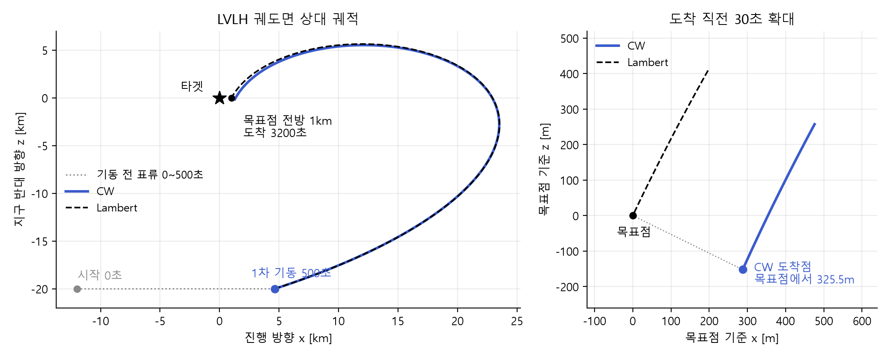

# 위성 랑데부 시뮬레이터

한국항공대학교 캡스톤디자인 A조 프로젝트입니다. 2026.03부터 진행 중이며 4인 중 팀장을 맡았습니다.

임펄스 기동으로 설계한 접근 궤적이 유한 연소와 지구 중력장 섭동이 있는 조건에서도 목표점에 닿도록 단계별로 검증했습니다.

## 문제와 목표

- 2체 임펄스 기동으로 계산한 접근 궤적에는 연소 시간과 섭동이 들어 있지 않습니다.
- 목표는 고도 500km 원궤도 타겟의 전방 1km 지점에 2,700초 비행 후 도착하는 2회 기동을 설계하고 유한 연소와 J2~J5 섭동 조건에서 목표점 오차와 총 ΔV를 비교해 보정하는 것입니다.

```
타겟    a 6878 km  e 0  i 45°  ν 0°
체이서  a 6858 km  e 0  i 45°  ν -0.1°   타겟보다 20 km 아래 약 12 km 뒤
1차 기동 500초   도착 3200초   시뮬레이션 종료 6000초
```

## 역할

| 구분 | 담당 |
|---|---|
| 본인 | 시뮬레이터 설계와 개발 총괄 / CW 기동 계산 / ECI와 LVLH 좌표변환 / RK4 궤도 전파 / 유한 연소 / J2~J5 섭동 / 재타겟팅 / MATLAB UI |
| 팀원1 | Lambert 솔버 `LambertSolver.m` / 유한 연소에 재타겟팅 적용 |

## 수행 내용

**1. 초기 접근 2026.03~06**
- CW 방정식으로 2회 임펄스 기동을 계산하고 ECI와 LVLH 좌표변환과 궤도 전파를 구현했습니다.
- 팀원1이 구현한 Lambert 솔버를 시뮬레이터에 통합했습니다.
- 팀원과 상태천이행렬 부호가 달라 Fehse의 책으로 수식을 확인하고 공통 기준을 정했습니다.

**2. 유한 연소 배치 2026.07~09**
- 최대 가속도를 입력하면 연소 시간이 정해지는 유한 연소 모델을 구현했습니다. 0.001km/s²에서 1차 약 16.3초 / 2차 약 15.1초 연소합니다.
- 연소를 기준 시각 앞과 가운데와 뒤에 두는 경우를 출발과 도착에 조합해 9가지를 비교했습니다.

**3. 섭동과 재타겟팅 2026.09**
- RK4 궤도 전파에 J2~J5 중력항을 넣고 기동량은 2체로 계산했습니다.
- 전이 도중 남은 경로를 다시 계산하는 재타겟팅을 임펄스 기동의 1850초와 2525초에 넣었습니다.

**4. 결과와 판단 2026.10**
- 팀원1이 재타겟팅을 유한 연소에 적용했습니다.
- 임펄스 기동에서 재타겟팅 시각을 도착 쪽으로 옮겨 가며 도착 오차와 총 ΔV를 비교했습니다.
- 연소 종료를 속도 차로 정하는 cut-off도 시험했습니다.

## 방법을 고른 이유

- CW는 선형 근사이고 Lambert는 비선형 2체 해라서 같은 조건에서 비교하면 선형화 오차의 크기를 먼저 알 수 있습니다.
- 연소 시점만 바꿔 비교하면 연소 시간이 목표점에 주는 영향을 다른 요인과 분리할 수 있습니다.
- 섭동을 J2부터 차례로 넣으면 어느 항이 오차를 키우는지 구분할 수 있습니다.
- 재타겟팅은 임펄스 기동에서 먼저 검증해야 연소 시간의 효과와 섞이지 않습니다.

## 결과

**1. CW와 Lambert 비교**
3200초 도착 오차는 CW 325.5m이고 Lambert는 1cm 미만입니다. 이후 단계에서는 Lambert를 기준 해로 두었습니다.



그림에서 볼 것은 두 궤적이 거의 겹치지만 확대하면 CW 도착점이 목표점에서 325.5m 벗어난다는 점입니다.

**2. 연소 배치 9가지 / 고정 연소창 / 3300초**
가운데에 둔 배치만 임펄스 기동과의 위치 차이가 CW 1.01m / Lambert 1.01m였고 나머지는 약 115m에서 1.35km였습니다. 가운데 배치를 이후 모든 실험의 기준으로 정했습니다. 1차 배치가 틀리면 약 1.35km이고 2차만 틀리면 약 115m라 출발 연소가 더 민감했습니다.


그림에서 볼 것은 가운데와 가운데 배치만 1m 수준으로 임펄스 기동과 맞는다는 점입니다.

**3. 섭동 모델별 목표점 오차 / 유한 연소 가운데 배치 / 6000초**

| 섭동 모델 | CW 오차 m | Lambert 오차 m |
|---|---:|---:|
| 섭동 없음 | 871.6 | 0.8 |
| J2 | 1,530.7 | 582.7 |
| J2~J5 | 1,527.0 | 578.9 |

오차 대부분이 J2에서 생기고 J3~J5 추가 차이는 약 4m라 2체 계산과 J2 비행의 차이를 원인으로 판단했습니다.

**4. 재타겟팅 횟수별 목표점 오차 / 임펄스 기동 / J2 / 6000초**

| 기동 횟수 | CW 오차 m | Lambert 오차 m | 총 ΔV CW / LAM m/s |
|---|---:|---:|---:|
| 2회 | 1,387.6 | 387.3 | 31.9 / 31.6 |
| 3회 재타겟팅 1회 | 342.9 | 215.7 | 31.7 / 31.6 |
| 4회 재타겟팅 2회 | 39.1 | 8.1 | 31.8 / 31.6 |

재타겟팅 2회로 총 ΔV를 거의 늘리지 않고 오차를 보정할 수 있었습니다.

**5. 유한 연소에 재타겟팅 적용 / 팀원1 수행 / J2 / 6000초**

| 기동 횟수 | CW 오차 m | Lambert 오차 m | CW 총 ΔV m/s | 임펄스 대비 m |
|---|---:|---:|---:|---:|
| 2회 | 1,384.8 | 384.3 | 31.89 | 2.9 |
| 3회 재타겟팅 1회 | 344.0 | 213.5 | 31.71 | 1.2 |
| 4회 재타겟팅 2회 | 39.4 | 7.8 | 31.84 | 0.6 |

유한 연소에서도 재타겟팅 2회로 CW 오차가 1,385m에서 39m로 줄었고 같은 조건의 임펄스 기동과 위치 차이는 0.6m였습니다.

**6. 재타겟팅 시각별 도착 오차와 총 ΔV / 임펄스 / J2 / 3200초**

| 재타겟팅 1회 시각 | CW 도착 오차 m | CW 총 ΔV m/s |
|---|---:|---:|
| 1850초 | 56.96 | 31.71 |
| 2525초 | 4.92 | 32.16 |
| 2900초 | 1.07 | 32.95 |
| 3058초 | 0.25 | 34.44 |

재타겟팅이 늦을수록 오차는 줄고 ΔV는 늘어납니다. 오차만 보면 늦은 재타겟팅이 유리하지만 정해진 ΔV 안에서 시각을 정해야 한다고 판단했습니다. cut-off는 개선이 작아 주된 보정은 재타겟팅으로 정했습니다.

## 계획

2026.11 초까지 가속도계 잡음을 모델링해 시뮬레이터에 넣고 몬테카를로로 목표점 오차 범위를 확인할 계획입니다.

## 실행 방법

MATLAB R2025b에서 확인했습니다. `src` 폴더에서 아래를 실행하면 UI가 열립니다.

```matlab
main_rendezvous
```

| 파일 | 내용 |
|---|---|
| `main_rendezvous.m` | UI와 결과 그래프 |
| `evaluate_maneuver_module.m` | 유한 연소 9가지 비교와 임펄스 기동 재타겟팅 / 유한 연소 재타겟팅은 팀원1 |
| `cw_stm_delta_v.m` | CW 상태천이행렬로 2회 기동 ΔV 계산 |
| `LambertSolver.m` | Lambert 문제 풀이 ΔV 계산 / 팀원1 작성 |
| `rk4_orbit_step.m` | RK4 궤도 전파 |
| `gravity_accel.m` | 2체 중력과 J2~J5 섭동 가속도 |
| `coe_to_rv.m` | 궤도 6요소를 ECI 위치와 속도로 변환 |
| `eci_to_lvlh.m` `make_lvlh_frame.m` | ECI와 LVLH 좌표변환 |

## 참조 문서

- NASA Johnson Space Center. *Orbit Targeting Specialist Function: Level C Formulation Requirements*. JSC-14393 78-FM-43. 1978.
- W. Fehse. *Automated Rendezvous and Docking of Spacecraft*. Cambridge University Press. 2003.
- 조동현 부산대학교. 우주비행체 랑데부&도킹 유도제어 강연 자료. 제29차 우주기술 단기강좌. 인하대학교. 2026.05.14.
