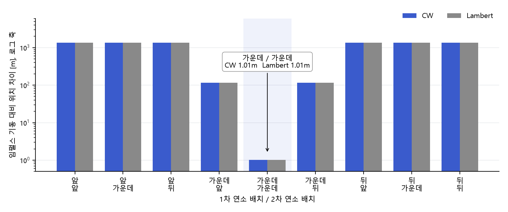

# 위성 랑데부 시뮬레이터

한국항공대학교 캡스톤디자인 A조 프로젝트입니다. 2026.03부터 진행 중이며 4인 중 팀장을 맡았습니다.

임펄스 기동으로 설계한 접근 궤적이 유한 연소와 지구 중력장 섭동이 있는 조건에서도 목표점에 닿도록 단계별로 검증했습니다.

## 문제와 목표

- 2체 임펄스 기동으로 계산한 접근 궤적에는 연소 시간과 섭동이 들어 있지 않습니다.
- 목표는 고도 500km 원궤도 타겟의 전방 1km 지점에 2,700초 비행 후 도착하는 2회 기동을 설계하고 유한 연소와 J2~J5 섭동 조건에서 목표점 오차와 총 ΔV를 비교해 보정하는 것입니다.

```
타겟    a 6878 km  e 0  i 45°  ν 0°
체이서  a 6858 km  e 0  i 45°  ν -0.1°   타겟보다 20 km 아래 약 12 km 뒤
1차 기동 500초   도착 3200초   시뮬레이션 종료 6000초
```

## 역할

| 구분 | 담당 |
|---|---|
| 본인 | 시뮬레이터 설계와 개발 총괄 / CW 기동 계산 / ECI와 LVLH 좌표변환 / RK4 궤도 전파 / 유한 연소 / J2~J5 섭동 / 재타겟팅 / MATLAB UI |
| 팀원 | Lambert 솔버 `LambertSolver.m` |

## 진행 단계와 결과

**1. 초기 접근 2026.03~06**
CW 방정식과 Lambert로 같은 조건의 2회 임펄스 기동을 계산해 비교했습니다. 3200초 도착 오차는 CW 325.5m이고 Lambert 1cm 미만입니다. 이후 단계에서는 Lambert를 기준 해로 두었습니다.

**2. 유한 연소 배치 2026.07~09**
최대 가속도 0.001km/s²에서 1차 약 16.3초 2차 약 15.1초 연소합니다. 연소를 기준 시각 앞과 가운데와 뒤에 두는 경우를 조합해 9가지를 비교했습니다. 가운데에 둔 배치만 임펄스 기동과의 위치 차이가 1.01m였고 나머지는 약 115m에서 1.35km였습니다.



그림에서 볼 것은 가운데와 가운데 배치만 1m 수준으로 임펄스 기동과 맞는다는 점입니다.

**3. 섭동과 재타겟팅 2026.09**
6000초 목표점 오차는 섭동 없음 871.6m에서 J2 1,530.7m로 커졌고 J2~J5는 1,527.0m였습니다. 오차 대부분이 J2에서 생긴다고 판단했습니다. 전이 도중 남은 경로를 다시 계산하는 재타겟팅을 1850초와 2525초에 넣었습니다.

**4. 유한 연소와 재타겟팅 2026.10**

| 기동 횟수 | CW 오차 m | Lambert 오차 m | CW 총 ΔV m/s |
|---|---:|---:|---:|
| 2회 | 1,384.8 | 384.3 | 31.89 |
| 3회 재타겟팅 1회 | 344.0 | 213.5 | 31.71 |
| 4회 재타겟팅 2회 | 39.4 | 7.8 | 31.84 |

유한 연소와 J2 조건에서 재타겟팅 2회로 CW 오차가 1,385m에서 39m로 줄었고 총 ΔV는 31.89m/s에서 31.84m/s로 거의 그대로였습니다. 재타겟팅 1회를 도착 직전인 3058초에 넣으면 오차는 0.25m까지 줄지만 총 ΔV가 34.44m/s로 늘어납니다.

## 실행 방법

MATLAB R2025b에서 확인했습니다. `src` 폴더에서 아래를 실행하면 UI가 열립니다.

```matlab
main_rendezvous
```

| 파일 | 내용 |
|---|---|
| `main_rendezvous.m` | UI와 결과 그래프 |
| `evaluate_maneuver_module.m` | 유한 연소 9가지 비교와 임펄스 기동 재타겟팅 |
| `cw_stm_delta_v.m` | CW 상태천이행렬로 2회 기동 ΔV 계산 |
| `LambertSolver.m` | Lambert 문제 풀이 ΔV 계산 / 팀원 작성 |
| `rk4_orbit_step.m` | RK4 궤도 전파 |
| `gravity_accel.m` | 2체 중력과 J2~J5 섭동 가속도 |
| `coe_to_rv.m` | 궤도 6요소를 ECI 위치와 속도로 변환 |
| `eci_to_lvlh.m` `make_lvlh_frame.m` | ECI와 LVLH 좌표변환 |

## 참조 문서

- NASA Johnson Space Center. *Orbit Targeting Specialist Function: Level C Formulation Requirements*. JSC-14393 78-FM-43. 1978.
- W. Fehse. *Automated Rendezvous and Docking of Spacecraft*. Cambridge University Press. 2003.
- 조동현 부산대학교. 우주비행체 랑데부&도킹 유도제어. 제29차 우주기술 단기강좌. 인하대학교. 2026.05.14.

## 계획

2026.11 초까지 가속도계 잡음을 모델링해 시뮬레이터에 넣고 몬테카를로로 목표점 오차 범위를 확인할 계획입니다.
