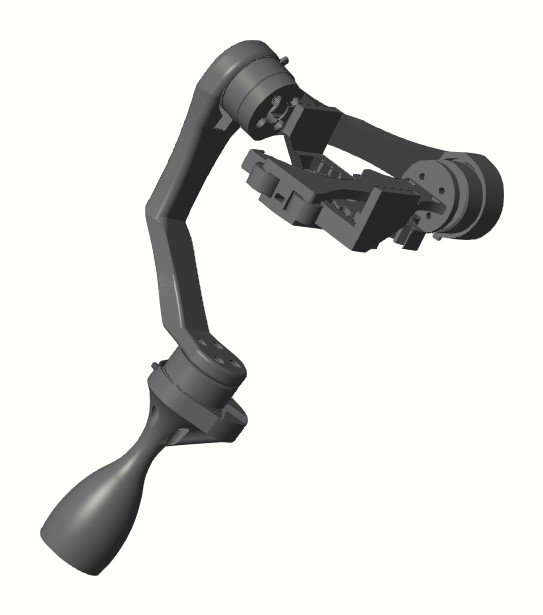

# 3축 짐벌 카메라 자세 제어

한국항공대학교 5인 팀 프로젝트입니다. 2025.10부터 2025.11까지 진행했고 팀원으로 참여했습니다.

3축 짐벌을 Simscape Multibody로 모델링하고 축별 PID 제어기와 Stateflow 모드 전환 로직을 하나의 모델로 통합했습니다.



## 문제와 목표

손 흔들림에도 카메라 자세를 유지하는 3축 짐벌을 Simscape Multibody 모델로 만들고 모드별 자세 제어를 검증하는 것이 목표였습니다.

## 역할

| 구분 | 담당 |
|---|---|
| 본인과 팀원1 | Simscape Multibody 3축 모델 / 축별 PID 제어 / Stateflow 로직을 제어 모델에 통합 |
| 팀원2 팀원3 팀원4 | Stateflow 모드 전환 로직 |

## 수행 내용

- CAD 부품 4개를 STEP으로 불러와 3축 회전 관절로 연결했습니다.
- Roll과 Pitch와 Yaw 축마다 목표 자세각 오차를 되먹임하는 PID 제어기를 두고 사인파 추종 / 정지 / 셀카 모드별로 게인을 설정했습니다.
- 목표각을 도 단위로 넣어 관절이 제대로 돌지 않던 문제를 라디안으로 바꿔 해결했습니다.
- Stateflow로 Lock 모드 On과 Off를 전환합니다.
  - Off에서 On이 되는 순간의 각도를 저장해 목표값으로 고정하고 외란이 들어와도 그 자세를 유지합니다.
  - On에서 Off가 되면 목표값을 현재 각도로 되돌립니다. Off에서는 Roll과 Pitch를 0도로 두어 수평을 유지하고 Yaw는 손잡이를 따라 움직이도록 현재값을 씁니다.
- Ramp 블록으로 Yaw 축에 각속도를 주어 Roll과 Pitch에 간접 외란을 만들고 자세가 벗어나는지 확인했습니다.

## 결과

- 셀카 모드에서 카메라를 180° 돌릴 때 0.42초 만에 목표 각도에 안정했고 오버슈트는 0.5%였습니다.
- 정지 모드에서 현재 자세를 유지할 때 흔들림은 1.1° 이하였습니다.
- Lock 모드에서 Yaw 목표값은 일정하게 유지되고 현재 각도는 잔류진동만 남기고 목표값에 수렴했습니다.
- 동작 영상은 `media/gimbal_move.mp4`에 있습니다.

## 실행 방법

MATLAB R2025b와 Simscape Multibody와 Stateflow가 필요합니다. 이 폴더에서 아래를 실행합니다.

```matlab
open_system('gimbal_algorithm_mode')
sim('gimbal_algorithm_mode')
```

| 파일 | 내용 |
|---|---|
| `gimbal_algorithm_mode.slx` | 최종 통합 모델 / Lock 모드 전환 포함 |
| `gimbal_algorithm_11_18.slx` | 2025.11.18 중간 모델 |
| `body.stp` `part2.stp` `part3.stp` `part4.stp` | 짐벌 부품 CAD |
| `media/gimbal_move.mp4` | 동작 영상 |

