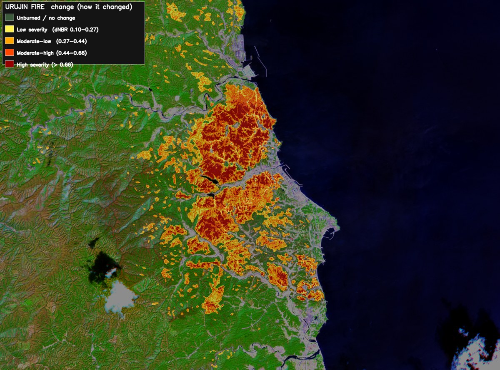

# KMU ET-02 큐브위성 온보드 AI 산불 탐지

누리호 6차 탑재 예정인 KMU ET-02 6U 큐브위성의 온보드 AI 다학제 캡스톤디자인 프로젝트입니다. 2026.07부터 진행 중이며 4인 중 팀원으로 참여했습니다.

울진 2022 산불 전후 Sentinel-2 영상으로 만든 소각 심각도 지도입니다.

## 문제와 목표

- 큐브위성은 UHF 다운링크가 좁아서 영상을 그대로 내려받기 어렵습니다.
- Sentinel-2 영상에서 산불 소각영역을 위성 안에서 찾고 결과를 폴리곤으로 바꿔 작은 용량으로 내려보내는 것이 목표입니다.

## 역할

- 온보드 탐지 모델과 벡터화 구현
- 검증용 웹앱 구현

## 수행 내용

- 소각 영역을 폴리곤으로 바꿔 다운링크하는 구조를 설계했습니다.
- 합성 산불 영상으로 만든 첫 모델의 결과를 검수해 자체 라벨을 만들었습니다.
- 보드 비용을 보고 ResNet34 인코더를 채택했습니다.

## 결과

- 소각영역을 폴리곤으로 바꿔 다운링크 용량을 2.51MB에서 18.7kB로 줄였습니다.
- UHF 전송 시간은 69.7분에서 31.1초가 됩니다. 울진 167km² 창을 4밴드 12bit로 보고 UHF 9,600bps에 링크 효율 0.5를 적용한 팀 공용 계산 기준입니다.
- 학습에 쓰지 않은 화재에서 F1이 산림청 라벨로는 0.05였지만 자체 라벨로는 0.81까지 올랐습니다.
- 안동 산불 배포 모델 기준 F1은 20m에서 0.9076이고 10m에서 0.8885입니다. 근거는 `산불/KNOWLEDGE.md`에 있습니다.

## 폴더 구성

| 폴더 | 내용 |
|---|---|
| `산불/KNOWLEDGE.md` | 확정된 결과와 미결 사항을 모은 문서 / 처음 읽을 곳 |
| `산불/역할분담_ARCHITECTURE.md` | 실시간 화염은 열적외 / Sentinel-2는 사후 정밀 평가로 역할을 나눈 근거 |
| `산불/울진산불_변화탐지/` | 울진 2022 산불 소각흔 변화탐지 / 메인 작업 |
| `산불/during_fire_distill/` | FIRMS 열탐지를 교사로 쓴 연소 중 탐지 실험 |
| `산불/mtbs_pretrain/` | 미국 MTBS 소실경계로 사전학습 후 한국 산불로 미세조정 |
| `산불/산불데이터/` | 일반화 검증용 실측 소실경계 모음 |
| `산불/미학습_데모_안동길안면_2025/` | 학습에 쓰지 않은 2025 안동 산불 데모 |
| `산불/근거사진/` | 발표용 그림과 그림 생성 코드 |
| `산불/작업기록/` | 날짜별 실험 기록과 인계 문서 |
| `산불_피해액환산/` | 소각면적을 피해액으로 환산하는 모듈과 기준 조사 |

## 실행 참고

국토지리정보원 API를 쓰는 코드는 환경변수 `NGII_APIKEY`에서 키를 읽습니다.

공통 원칙은 Sentinel-2 광학 영상만 쓰고 SAR는 쓰지 않는 것입니다.
