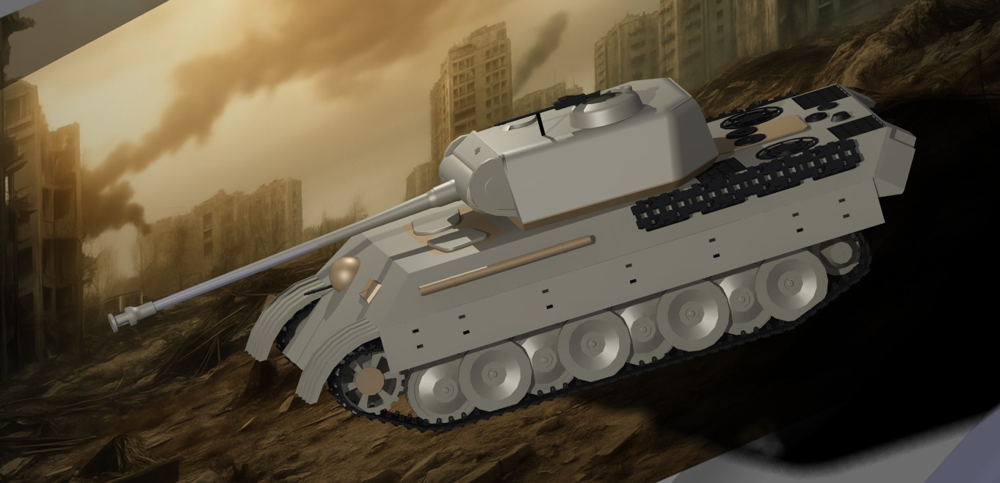

# CATIA 전차 역설계 모델링

2025년 1학기 텀 프로젝트로 5인 팀에서 팀원으로 참여했습니다. 2025.06.13에 최종 발표했습니다.

## 문제와 목표

- 전차의 구동 방식과 내부 구조를 CATIA로 구현하고 키네마틱스 기능으로 움직임을 확인해 보고 싶었습니다.
- 실제 전차 도면은 구하기 어려워서 판터 전차 프라모델을 각도계와 줄자로 직접 실측해 역설계했습니다.

## 역할

| 구분 | 주 역할 | 부 역할 |
|---|---|---|
| 본인 | 상판 어셈블리 | 도면 / 발표자료 |
| 팀원1 | 하판 파트 디자인 / 하판 어셈블리 | 상판과 하판 결합 / 발표자료 |
| 팀원2 | 포신 파트 제작과 어셈블리 / 렌더링 | 도면 / 발표자료 |
| 팀원3 | 상판 파트 디자인 / 바퀴 어셈블리 | 발표 |
| 팀원4 | DMU / 엔진 / 도색 | 체인 결합 |

세부 파트 제작과 어셈블리 확인은 다섯 명이 함께 맡았습니다.

## 수행 내용

- 프라모델을 실측해 역설계 도면을 작성했습니다.
- 전차를 상판과 하판과 포신 모듈로 나누고 제작 우선순위를 정해 파트를 만든 뒤 모듈별로 어셈블리했습니다.
- 모듈을 합친 뒤 도색과 DMU 시뮬레이션과 렌더링을 진행했습니다.

## 결과

- 총 462개 파트로 전차 전체를 조립했습니다.
- DMU로 조립한 전차의 움직임을 확인했습니다. 영상은 `media/dmu.mp4`에 있습니다.

## 파일

| 파일 | 내용 |
|---|---|
| `CATIA_전차_역설계_발표.pdf` | 최종 발표자료 15쪽 |
| `media/final_render.jpg` | 최종 렌더링 |
| `media/assembly.jpg` | 전체 어셈블리 |
| `media/dmu.mp4` | DMU 동작 영상 |
